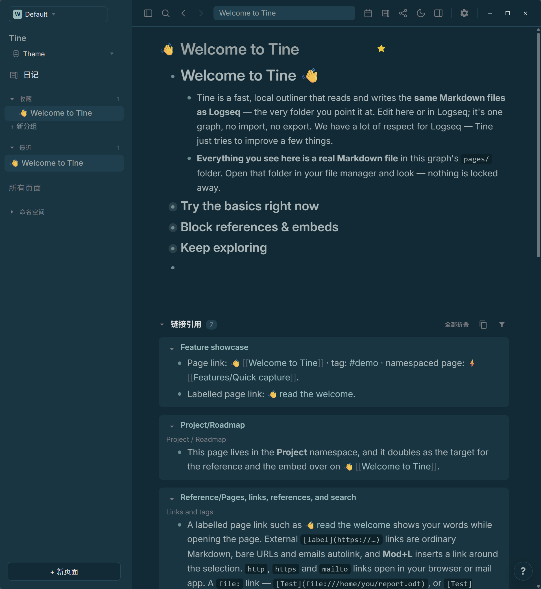
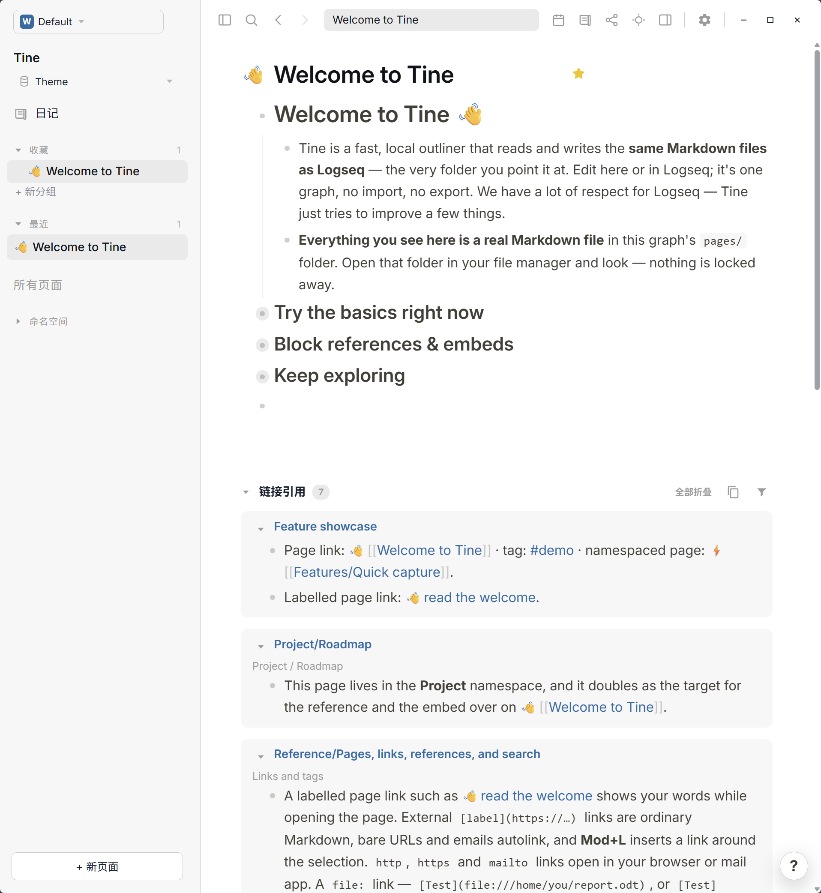

# Logseq Classic · Prism

**A familiar page in daylight; deep blue-green stillness after dusk.**

[Download theme.json](https://github.com/EllisMorrow/tine-theme-logseq-classic-prism/releases/latest/download/theme.json) · [中文说明](README.zh-CN.md) · [Adaptation notes](docs/adaptation.md)

A community adaptation of the classic Logseq palette: white pages and warm-gray text in daylight, deep blue-green surfaces and gray-green text after dusk. Both modes are included in one package.

Explore the [Prism theme gallery](https://github.com/martinkoutecky/tine/discussions/786) to compare the collection in light and dark modes.

### Dark mode

### Light mode

## Install

1. Download `theme.json` using the link above.
2. In Tine open **Settings → Appearance → Theme packages → Select theme.json**.
3. Choose **Use colors**, then Light, Dark or System mode.

Requires Theme API 0.2. Existing `custom.css` and device accent settings may affect the result. This package supplies colors; typography, layout and unsupported roles remain host-controlled.

## Palette

| Role | Light | Dark |
| --- | --- | --- |
| Canvas | `#ffffff` | `#002b36` |
| Sidebar | `#f7f7f7` | `#023643` |
| Body | `#433f38` | `#a4b5b6` |
| Heading | `#0f1419` | `#93a1a1` |
| Accent | `#0069b6` | `#8ec2c2` |
| Links | `#106ba3` | `#8abbbb` |
| Tags | `#106ba3` | `#8abbbb` |
| Mark background | `#fef3ac` | `#fef3ac` |

## Sources and thanks

Colors are adapted from the [Logseq classic palette](https://github.com/logseq/logseq/blob/e7e9c97c7fcb9c95d1bea156124a12bb20eea053/src/main/frontend/shui/vars-classic.css), pinned at `e7e9c97c7fcb9c95d1bea156124a12bb20eea053`, under the upstream [AGPL-3.0 license](https://github.com/logseq/logseq/blob/e7e9c97c7fcb9c95d1bea156124a12bb20eea053/LICENSE.md). This adaptation is distributed under **AGPL-3.0-only**; see [LICENSE](LICENSE) and [NOTICE](NOTICE.md) for source and change notices. Upstream colors are not claimed as our original work.

Thanks to [jjc62](https://github.com/jjc62) for the [suggestion and comparison](https://github.com/martinkoutecky/tine/discussions/786#discussioncomment-19309264) that prompted this theme. Colors were checked against upstream and mapped to Tine roles; the dark selection background is adapted. This is an unofficial community theme with no affiliation or endorsement by Logseq or Tine. Tine adaptation by EllisMorrow, developed with AI assistance.

## Validation and feedback

The official format checker passed. A Chromium fixture verified both sets of 21 tokens, mode switching and specified contrast pairs. The user supplied the Windows captures above after disabling custom overrides. They document the welcome page, not all interactions, Settings or platforms, and do not establish pixel-exact correspondence to the manifest. See [check results](docs/local-check.md) and [screenshot notes](docs/screenshots.md).

The badge counts Release asset downloads, not installations or unique users. [Report an issue](https://github.com/EllisMorrow/tine-theme-logseq-classic-prism/issues).
