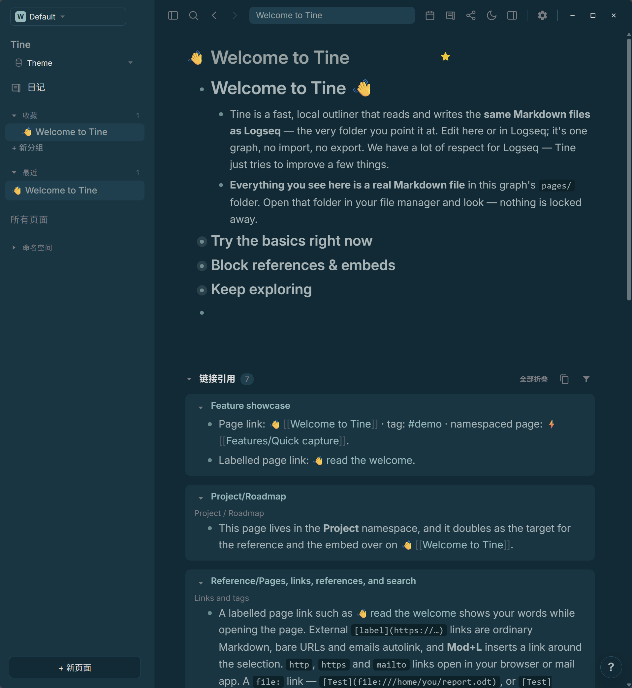
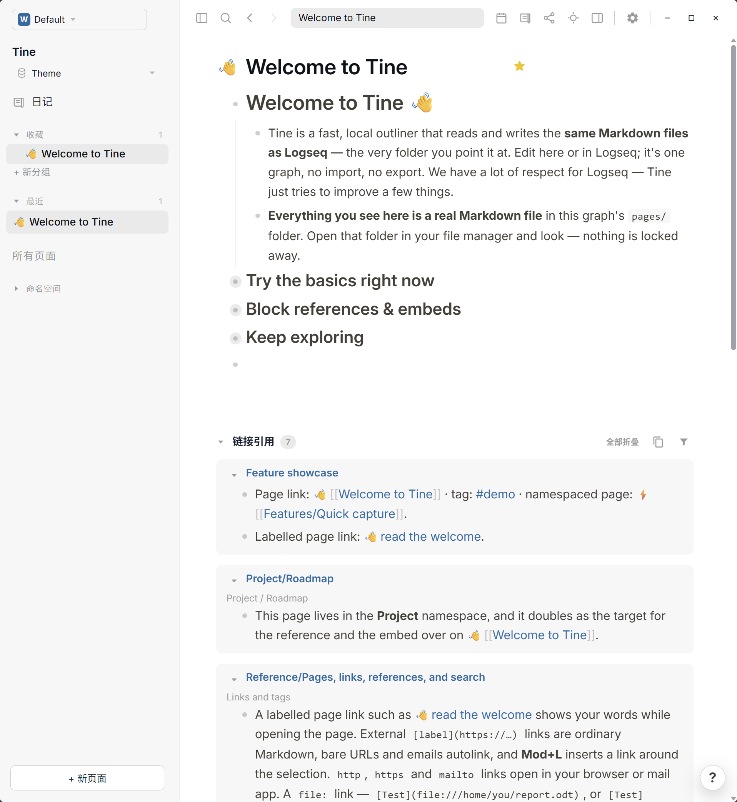

# Logseq Classic · Prism

**白日如熟悉的纸页，入夜归于深静的蓝绿。**

[下载 theme.json](https://github.com/EllisMorrow/tine-theme-logseq-classic-prism/releases/latest/download/theme.json) · [English](README.md) · [适配说明](docs/adaptation.md)

Logseq 经典配色的 Tine 社区适配：浅色以白底和暖灰文字为主，深色以深蓝绿背景搭配灰绿文字。一个主题包包含两套配色。

浏览 [Prism 主题展示](https://github.com/martinkoutecky/tine/discussions/786)，对比系列主题的浅色与深色效果。

### 深色模式

### 浅色模式

## 安装

1. 下载上方的 `theme.json`。
2. 在 Tine 打开 **设置 → 外观 → 主题包 → 选择 theme.json**。
3. 点击 **使用颜色**，再选择浅色、深色或跟随系统。

需要 Theme API 0.2。个人 `custom.css` 和设备强调色可能影响效果。本包只提供颜色；字体、布局和其它不支持的角色由 Tine 控制。

## 配色

| 角色 | 浅色 | 深色 |
| --- | --- | --- |
| 主背景 | `#ffffff` | `#002b36` |
| 侧栏 | `#f7f7f7` | `#023643` |
| 正文 | `#433f38` | `#a4b5b6` |
| 标题 | `#0f1419` | `#93a1a1` |
| 强调色 | `#0069b6` | `#8ec2c2` |
| 链接 | `#106ba3` | `#8abbbb` |
| 标签 | `#106ba3` | `#8abbbb` |
| 高亮背景 | `#fef3ac` | `#fef3ac` |

## 来源与致谢

配色取自 [Logseq 经典配色源码](https://github.com/logseq/logseq/blob/e7e9c97c7fcb9c95d1bea156124a12bb20eea053/src/main/frontend/shui/vars-classic.css)，固定版本 `e7e9c97c7fcb9c95d1bea156124a12bb20eea053`，上游采用 [AGPL-3.0](https://github.com/logseq/logseq/blob/e7e9c97c7fcb9c95d1bea156124a12bb20eea053/LICENSE.md)。本适配同样以 **AGPL-3.0-only** 发布，完整许可和改动说明见 [LICENSE](LICENSE) 与 [NOTICE](NOTICE.md)。不将上游配色声明为我们的原创。

感谢 [jjc62](https://github.com/jjc62) 的[建议与对比](https://github.com/martinkoutecky/tine/discussions/786#discussioncomment-19309264)，促成了独立主题的制作。颜色依据上游核对并映射到 Tine；深色选区为适配值。此主题为非官方社区作品，与 Logseq 和 Tine 官方无从属或背书关系。由 EllisMorrow 适配，开发使用 AI 辅助。

## 验证与反馈

通过官方主题格式检查；浏览器样例验证两套 21 个变量、明暗切换及指定对比度组合。用户在禁用自定义覆盖后提供了上方 Windows 实机截图。截图展示欢迎页，不代表所有交互、设置或平台都已测试，也不保证像素颜色与清单完全一致。见[检查记录](docs/local-check.md)和[截图说明](docs/screenshots.md)。

下载徽标统计 GitHub Release 附件下载量，不代表安装人数。[反馈问题](https://github.com/EllisMorrow/tine-theme-logseq-classic-prism/issues)。
